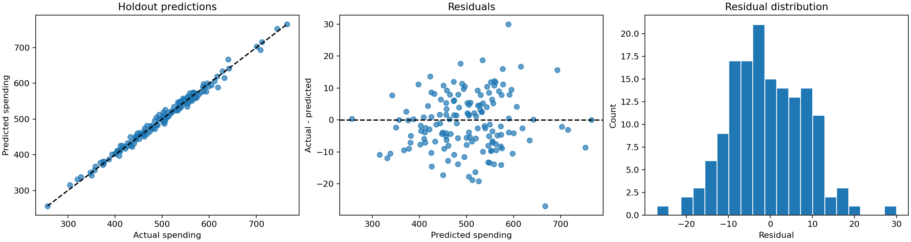

# E-commerce Customer Spending Prediction

An interpretable multiple linear regression project that estimates yearly customer spending from four behavioral features. Includes reproducible evaluation, a Streamlit application and automated tests.

## Results

500 observations; 350 training rows and 150 held-out test rows. The original project's 70/30 split and random seed (101) are preserved.

| Model | Test MAE | Test RMSE | Test R² |
| --- | ---: | ---: | ---: |
| Linear regression | 7.228 | 8.934 | 0.9890 |
| Training-mean baseline | 66.634 | 85.221 | -0.0005 |

Five-fold shuffled cross-validation uses **training rows only**: RMSE **10.481 ± 1.266**, MAE **8.402 ± 1.017**, R² **0.9793 ± 0.0071** (mean ± fold standard deviation, not a confidence interval). No hyperparameter search or test-driven model selection was performed.



These are educational dataset results, not evidence of production performance.

## Quick start

Use Python 3.11–3.13. Run all commands from this repository's root.

```bash
python -m venv .venv
```

Activate on Windows PowerShell: `.venv\Scripts\Activate.ps1`.
On macOS/Linux: `source .venv/bin/activate`.

```bash
python -m pip install -r requirements.txt
python -m spending.train
python -m streamlit run streamlit_app.py
```

The application trains the small model in memory once per application process and caches it. It does not download data or load pickled models. Its model is trained on the same 350 rows used for the reported evaluation; it is not refitted on the test set.

## Application

- Enter session length, app time, website time and membership length.
- See yearly spending predictions and warnings for inputs outside training ranges.
- Inspect test metrics, the mean baseline, cross-validation, coefficients and residuals.

The supplied dataset does not establish currency or time units, so the interface uses dataset units rather than inventing dollars or years. Predictions are unconstrained and can become negative under extrapolation; those outputs are flagged.

## Repository structure

```text
data/                       Numeric dataset and provenance notes
spending/model.py           Schema validation, training and prediction
spending/train.py           Reproducible report generation
streamlit_app.py            Interactive application
tests/                      Model validation and application interaction tests
reports/                    Metrics, coefficients, test predictions and plots
.github/workflows/tests.yml GitHub Actions checks
requirements.txt            Application dependencies
requirements-dev.txt        Test dependencies
```

## Methodology

The four original predictors are retained: `Avg. Session Length`, `Time on App`, `Time on Website`, `Length of Membership`. The target is `Yearly Amount Spent`.

Email, Address and Avatar are excluded from both modeling and the delivered numeric dataset. Loading rejects missing columns, nonnumeric or nonfinite values, negative values, duplicate feature profiles and constant targets instead of silently modifying the training sample. Review invalid data rather than blindly dropping records.

An ordinary least squares model with an intercept preserves the original approach. No scaling is necessary for this unregularized linear model. No learned preprocessing happens before the split. Five-fold training validation estimates variability; the held-out test set supplies the final evaluation. Coefficients are in original feature units and describe associations, not causal effects. A small website-time coefficient does not prove that website investment is ineffective.

## Reproduce and test

```bash
python -m pip install -r requirements-dev.txt
python -m pytest -q
python -m spending.train
```

Optional paths:

```bash
python -m spending.train --data data/customers.csv --output reports
```

Reports include the data SHA-256 fingerprint, environment versions, fold scores and split settings. The main scientific dependencies are pinned; the supported Streamlit and pytest ranges may resolve newer compatible versions. See `reports/VALIDATION.md` for the actual local check environment. GitHub Actions reruns the checks after publication; no hosted CI run is claimed here.

## Publish on GitHub and deploy

1. Confirm redistribution rights for the course dataset; see `data/README.md`.
2. Create an empty GitHub repository, then run:

```bash
git init
git add .
git commit -m "Add customer spending regression and Streamlit demo"
git branch -M main
git remote add origin https://github.com/YOUR_USERNAME/ecommerce-spending-prediction.git
git push -u origin main
```

3. In Streamlit Community Cloud, select the repository, branch `main` and entrypoint `streamlit_app.py`; use Python 3.13 to match local validation. The root `requirements.txt` supplies dependencies. See the [official deployment guide](https://docs.streamlit.io/deploy/streamlit-community-cloud/deploy-your-app).

No credentials are required. Do not commit secrets. Add a code license appropriate to your ownership before inviting reuse; no third-party dataset license is inferred or granted by this package.

## Limitations and next steps

Dataset origin, collection process, units and license have not been verified. A random split assumes independent observations; unseen populations, repeated customers or future drift require a different validation design. Residual plots are descriptive checks, not a formal demonstration of regression assumptions. No calibrated prediction interval is provided. Investigate external validity, temporal validation where applicable, and residual behavior before practical use.

The refactor replaces the original monolithic `LR.py`; there is no separate legacy copy to maintain. It adds reusable functions, explicit checks, a baseline, cross-validation, R², exportable reports, application tests and deployment instructions.

Technical references: [scikit-learn validation](https://scikit-learn.org/stable/modules/cross_validation.html), [Streamlit application testing](https://docs.streamlit.io/develop/concepts/app-testing/get-started).
